# Yunmai Massage Gun Pro (YMFG-B563) — Hardware Reverse Engineering & Diagnostic Guide


Comprehensive reverse engineering archive, hardware teardown analysis, PCB circuitry inspection, connector pinouts, safety hazard documentation, and Arduino 25 kHz motor driver test rig for the **Yunmai Massage Gun Pro (Model YMFG-B563)** high-torque percussion massager.

---

## Table of Contents
1. [Device Overview & Hero Photo](#1-device-overview)
2. [Technical Specifications](#2-technical-specifications)
3. [Mechanical Teardown Walkthrough](#3-mechanical-teardown-walkthrough)
4. [Electronic Hardware Architecture & Mainboard Analysis](#4-electronic-hardware-architecture--mainboard-analysis)
5. [Connector Pinouts & Signal Analysis](#5-connector-pinouts--signal-analysis)
6. [Critical Color-Coding Hazard Warning](#6-critical-color-coding-hazard-warning)
7. [Arduino Test Harness & 25 kHz Motor Driver](#7-arduino-test-harness--25-khz-motor-driver)
8. [Diagnostic Guide & Troubleshooting Fault Tree](#8-diagnostic-guide--troubleshooting-fault-tree)
9. [Complete Repository File Catalog](#9-complete-repository-file-catalog)
10. [Safety Disclaimers & Licensing](#10-safety-disclaimers--licensing)

---

## 1. Device Overview

The **Yunmai Massage Gun Pro (Model YMFG-B563)** is a premium percussion therapy device manufactured by Shenzhen Yunmai Technology Co., Ltd. Designed for deep-tissue myofascial release, it features:
- A high-torque **Dongguan E-S Motor 2430BL brushless DC (BLDC) motor** with an **integrated 3-phase driver inverter**.
- A high-capacity **6S1P 21.6V lithium-ion battery pack (56.16 Wh)** with dedicated BMS protection.
- A heavy-duty **crank-slider reciprocating percussion mechanism** supported by precision **Singapore NMB 608Z shielded miniature ball bearings**, delivering a 12 mm percussive stroke.
- A supervisory microcontroller board (**`YM-B563-MAIN-V0.3`**) managing high-frequency ultrasonic PWM speed modulation, tachometer feedback, locked-rotor protection, and battery management.

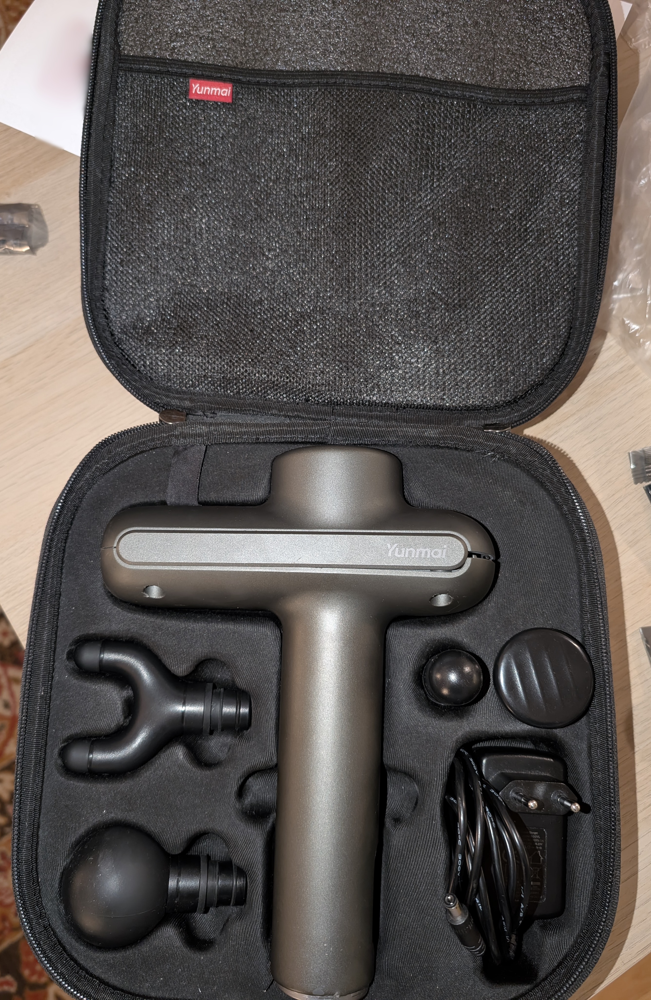
*Figure 1: Yunmai Massage Gun Pro carrying case with four specialized massage attachments and charger.*

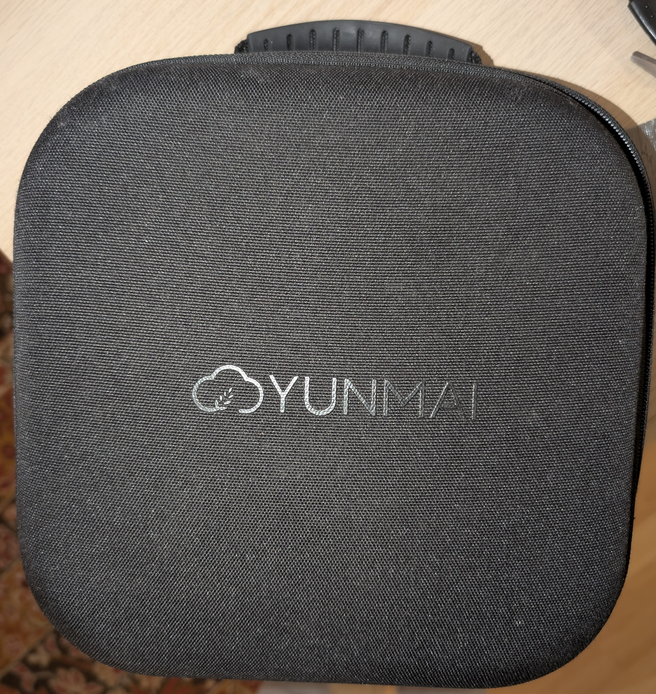
*Figure 2: Exterior carrying case featuring embossed Yunmai branding.*

---

## 2. Technical Specifications

| Parameter | Specification / Engineering Measurement | Documentation Reference |
|---|---|---|
| **Product Model** | **YMFG-B563** | Rating plate, Factory User Manual p. 36 |
| **Manufacturer** | Shenzhen Yunmai Technology Co., Ltd. | Factory User Manual |
| **Net Device Weight** | **1.0 kg (2.2 lbs)** | Factory User Manual p. 36 |
| **Device Dimensions** | 183 mm × 230 mm × 71 mm | Factory User Manual p. 36 |
| **Battery Type** | Rechargeable 6S1P (6INR19/66) Cylindrical Li-ion | JETECH Battery Label `JT-ESB06-05` |
| **Battery Voltage** | **DC 21.6V nominal** (25.2V max charged, 18.0V cutoff) | JETECH Battery Label `JT-ESB06-05` |
| **Battery Capacity** | **2.6 Ah (2600 mAh) / 56.16 Wh** | JETECH Battery Label `JT-ESB06-05` |
| **Battery Management** | JETECH-90606-V3 BMS (over-charge, over-discharge, short-circuit)| Hardware PCB inspection |
| **Charger Input** | 100–240V ~ 50/60 Hz, 1.0A Max AC | QSHAIN Charger Label `YNQX36G260100VL` |
| **Charger Output** | **26.0V DC == 1.0A (26.0W)**, center-positive barrel | QSHAIN Charger Label `YNQX36G260100VL` |
| **Charge Time** | Approximately 4 hours from empty | Factory User Manual p. 36 |
| **Motor Model** | **Dongguan E-S Motor 2430BL** series BLDC | Motor manual datasheet & silkscreen |
| **Motor Driver** | Integrated 3-phase BLDC controller in motor housing | Hardware PCB analysis |
| **Motor Rated Power** | ~60W peak continuous percussive power | Hardware analysis |
| **Speed Settings** | 3 Intensity Gears + Neutral/Standby Mode | Factory User Manual p. 33 |
| **Gear 1 Speed** | **1,800 RPM (30 Hz percussion frequency)** | Measured / Tachometer FG 180 Hz |
| **Gear 2 Speed** | **2,400 RPM (40 Hz percussion frequency)** | Measured / Tachometer FG 240 Hz |
| **Gear 3 Speed** | **3,200 RPM (53.3 Hz percussion frequency)** | Measured / Tachometer FG 320 Hz |
| **Percussion Stroke** | **11–12 mm peak-to-peak linear stroke** | Mechanical measurement |
| **Operating Autonomy** | Up to 14 hours (low load) / 4–6 hours (continuous heavy load) | Factory User Manual p. 36 |
| **Safety Cutoffs** | 10-Minute Continuous Run Timer & Locked-Rotor Protection | Factory User Manual p. 37 |

---

## 3. Mechanical Teardown Walkthrough

The mechanical structure is engineered to withstand extreme dynamic acceleration while dampening percussive vibrations transferred to the user's arm. For the comprehensive mechanical analysis, refer to [docs/mechanical-teardown.md](docs/mechanical-teardown.md).

### 3.1 Structural Housing & Clamshell Disassembly
The outer shell is molded from thick ABS/polycarbonate composite. The interior walls feature ribbed acoustic baffles and elastomeric suspension cradles that isolate the drive train from the exterior shell.

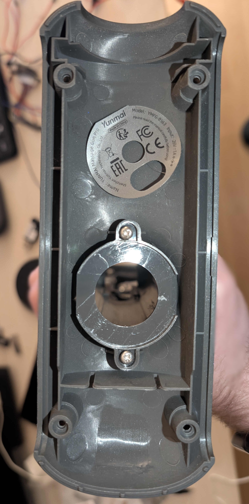
*Figure 3: Interior of the outer clamshell housing showing acoustic damping ribs and chassis alignment seats.*

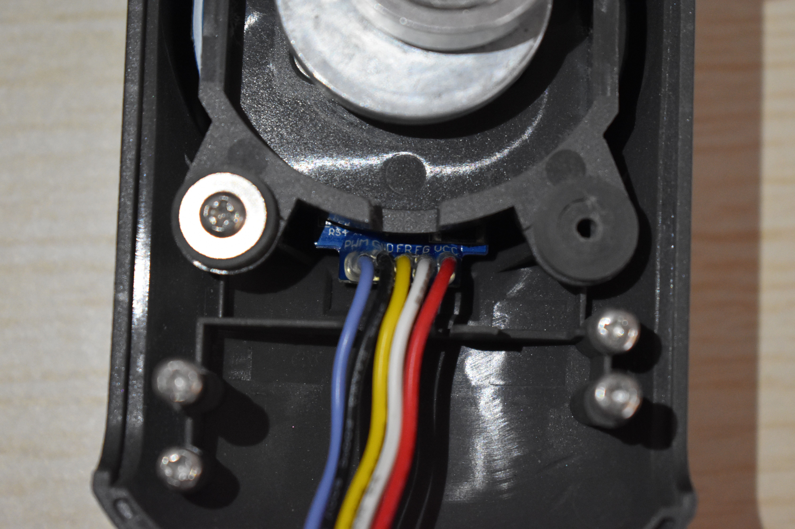
*Figure 4: Cast aluminum internal chassis bracket providing rigid mounting for motor and linear cylinder.*

### 3.2 Percussion Drive & Precision Bearings
The rotary-to-linear conversion relies on an eccentric crank-slider mechanism:
1. **Flywheel Counterweight**: Clamped to the motor shaft, counteracting the inertial recoil of the reciprocating piston.
2. **Connecting Rod**: Precision-machined aluminum link connecting the eccentric crank pin to the piston wrist pin.
3. **Singapore NMB 608Z Bearings**: Dual shielded precision miniature ball bearings support the crankshaft and connecting rod, ensuring low-friction rotation at 3,200 RPM.

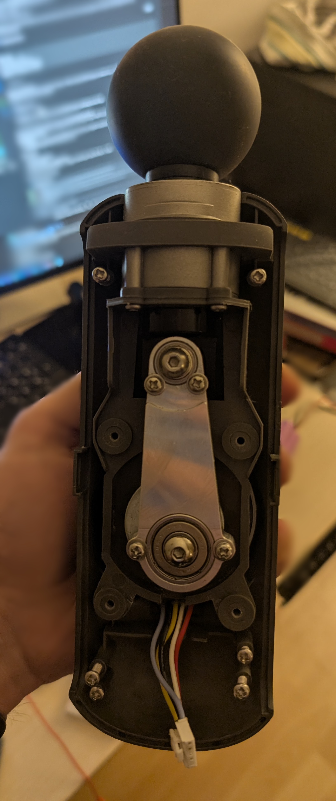
*Figure 5: Eccentric flywheel, connecting rod, and linear piston assembly mounted in the internal chassis.*

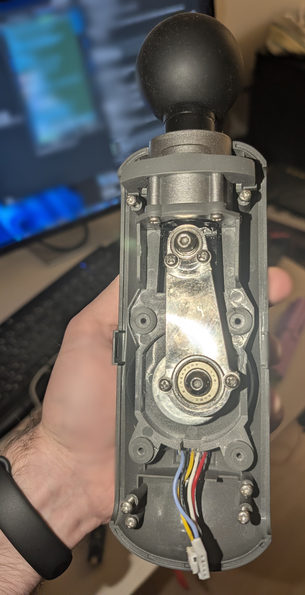
*Figure 6: Macro closeup of the Singapore NMB shielded ball bearing seated inside the connecting rod journal.*

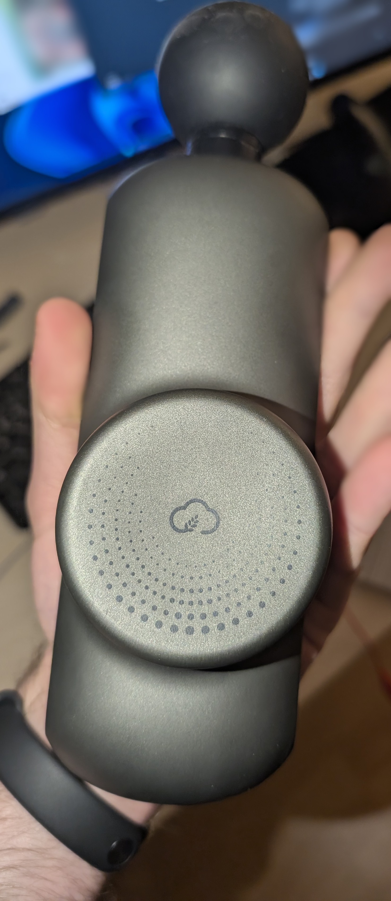
*Figure 7: Reciprocating linear piston and self-lubricating cylinder guide sleeve.*

### 3.3 Motor Mount, Handle Cavity & Base
The motor is secured into the die-cast chassis with front faceplate screws and a rear retention bracket. The handle cavity retains the 6S battery pack, terminating at the base in a rocker switch and DC power jack.

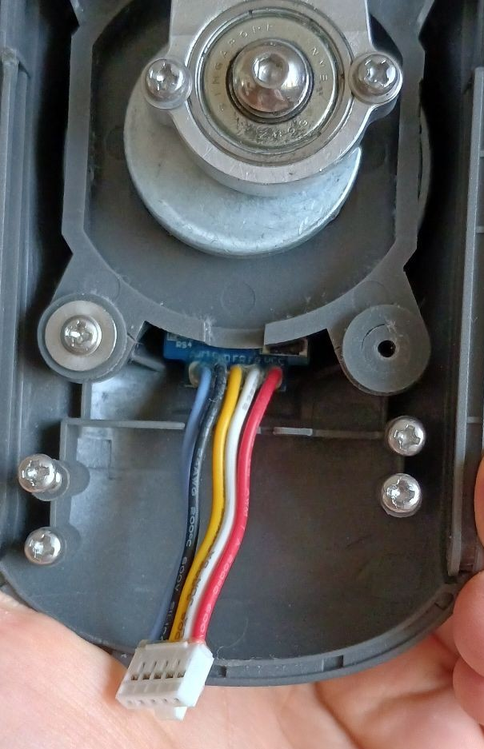
*Figure 8: Motor front faceplate mounting showing wire harness routing.*

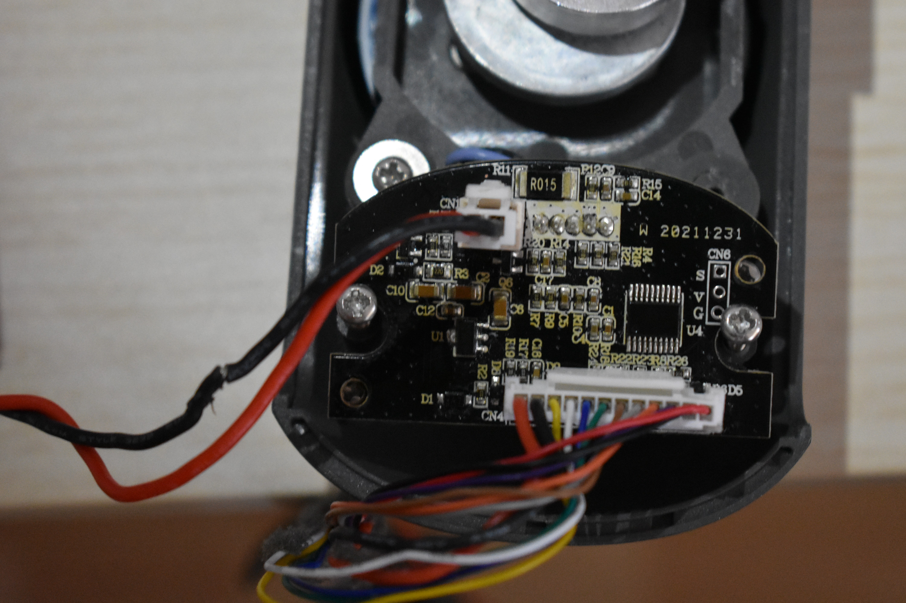
*Figure 9: Rear motor backplate mounting securing the motor stator into the internal frame.*

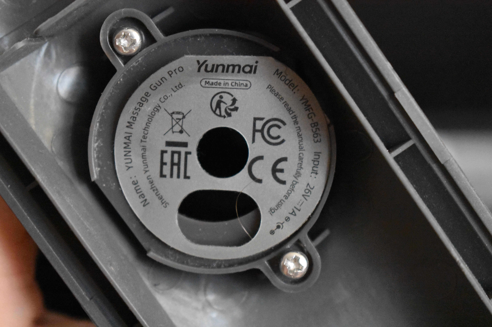
*Figure 10: Device rating plate detailing Model YMFG-B563 and electrical parameters.*

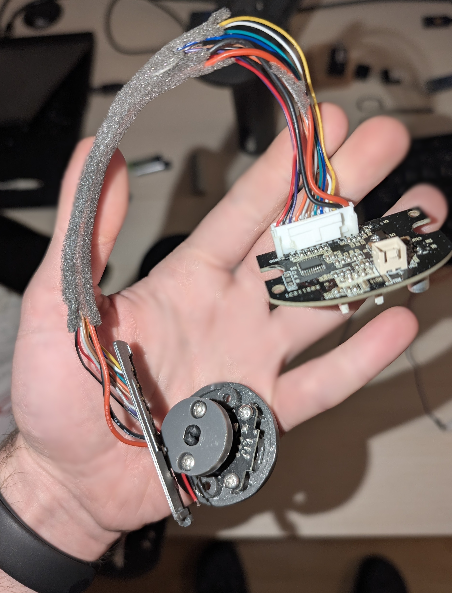
*Figure 11: Handle cavity with longitudinal alignment ribs and harness channel.*

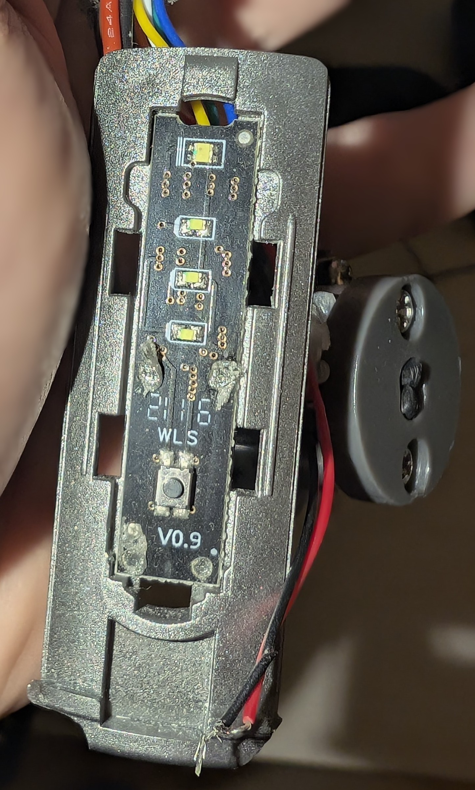
*Figure 12: Base end-cap cavity holding the rocker switch and charging jack.*

---

## 4. Electronic Hardware Architecture & Mainboard Analysis

The main motherboard carries the silkscreen identification **`YM-B563-MAIN-V0.3`** (Date: 2021-09-22). For the full component breakdown and schematic trace, see [docs/hardware-analysis.md](docs/hardware-analysis.md).


*Figure 13: Studio macro shot of mainboard top side showing buck converter choke, 50V caps, and CN2 connector.*


*Figure 14: Studio macro shot of mainboard underside showing TSSOP-20 MCU U4 and current shunt R015.*

### Key Mainboard Subsystems
1. **High-Voltage Step-Down Buck Converter**:
   - Reduces raw 21.6V–26.0V DC bus voltage to a 5.0V intermediate logic rail.
   - Inductor marked **`470`** (47 µH shielded SMD power inductor).
   - Dual high-voltage electrolytic filter capacitors rated **`47 50V SD`** (47 µF, 50V working voltage), offering substantial margin above the 26V charging threshold.
   - SOT-89 linear regulator (`U1`) further steps 5V down to 3.3V for microcontroller logic.
2. **Microcontroller (`U4`)**:
   - TSSOP-20 packaged microcontroller responsible for user button debouncing, UI LED sequencing, 25 kHz active-LOW PWM generation, FG pulse frequency counting, and safety interlocks.
   - Programming test port **`CN6`** on PCB underside provides 3 pads silkscreened **`S`** (Signal/SWDIO), **`V`** (VDD 3.3V), and **`G`** (Ground).
3. **Low-Side Current Shunt (`R015`)**:
   - Precision **15 mΩ (0.015 Ω)** metal shunt resistor in the motor ground return path.
   - Senses motor current draw to trigger instant shutdown upon locked-rotor or stall events.
4. **Battery Pack & BMS**:
   - JETECH `JT-ESB06-05` 6S lithium-ion pack (21.6V nominal, 2600 mAh, 56.16 Wh).
   - `JETECH-90606-V3` protection board with balance taps `B-` through `B+`.


*Figure 15: JETECH JT-ESB06-05 21.6V battery pack rating label.*


*Figure 16: QSHAIN 26V 1.0A power adapter specification plate.*


*Figure 17: User interface board (2116 WLS V0.9) front face with SMD indicator LEDs and tactile push button.*

---

## 5. Connector Pinouts & Signal Analysis

For complete connector pinout diagrams and waveform analyses, see [docs/pinouts-and-signals.md](docs/pinouts-and-signals.md).

### 5.1 Motor Interface Connector (`CN2`)
The 5-pin shrouded connector **`CN2`** at the top edge of the mainboard interfaces directly with the Dongguan E-S Motor 2430BL integrated driver.

| Pin | Wire Color | Label | Function | Operating Levels |
|:---:|:---:|:---:|:---|:---|
| **1** | **Red** (Thick) | `VCC` / `Vm` | Motor High-Voltage DC Supply | 21.6V – 26.0V DC (Direct from battery) |
| **2** | **White** (Thick) | `FG` | Hall Speed Tachometer Feedback | 0–5V open-collector pulse train (**6 pulses per mechanical revolution**) |
| **3** | **Yellow** (Thick) | `FR` | Direction Control (Forward / Reverse) | Logic Level: $V_{IL} \le 0.5\text{V}$ = Clockwise (CW), $V_{IH} \ge 2.0\text{V}$ / Open = CCW |
| **4** | **Black** (Thick) | `GND` | Motor Power Ground | 0V System Ground Return |
| **5** | **Blue** (or Purple) | `PWM` | High-Frequency Speed Control | Active-LOW ultrasonic PWM (**15 kHz – 25 kHz**, max 60 kHz) |


*Figure 18: Dongguan E-S Motor 25SG-2430BL manufacturer specification sheet detailing pin definitions and active-LOW logic.*

### 5.2 UI & Power Connector (Bottom Edge Pad Array)
The 12 hand-soldered pads along the bottom edge of motherboard `YM-B563-MAIN-V0.3`:

| Pad Label | Wire Color | Wire Gauge | Connected Subsystem | Electrical Role |
|---|---|---|---|---|
| **`DC+`** | Black | Thick | Charging Barrel Socket | +26.0V DC charging input |
| **`DC-`** | Black | Thick | Charging Barrel Socket | 0V charging ground return |
| **`1`** | **Yellow** | Thin | UI Board (`2116 WLS`) | Common Anode (+5V) for all 4 SMD LEDs |
| **`2`** | **White** | Thin | UI Board (`2116 WLS`) | Cathode: Power indicator Red LED |
| **`3`** | **Blue** | Thin | UI Board (`2116 WLS`) | Cathode: Power indicator White LED |
| **`4`** | **Green** | Thin | UI Board (`2116 WLS`) | Cathode: Gear 1/3 indicator LED |
| **`5`** | **Brown** | Thin | UI Board (`2116 WLS`) | Cathode: Gear 2/3 indicator LED |
| **`6`** | **Grey** | Thin | UI Board (`2116 WLS`) | Cathode: Gear 3/3 indicator LED |
| **`7`** | **Orange** | Thin | UI Board (`2116 WLS`) | Tactile Shift Button Terminal A |
| **`8`** | **Violet** | Thin | UI Board (`2116 WLS`) | Tactile Shift Button Terminal B |
| **`KEY`** | **Black** | Thin | Bottom Rocker Power Switch | Logic power-on sense input |
| **`GND`** | **RED** | Thin | Bottom Rocker Power Switch | **Logic Ground Reference** (See hazard warning below!) |

---

## 6. Critical Color-Coding Hazard Warning

> ⚠️ **CRITICAL ELECTRICAL HAZARD — NON-STANDARD WIRE COLOR VIOLATION** ⚠️
> 
> On the bottom solder pad array of motherboard **`YM-B563-MAIN-V0.3`**, the factory wiring harness violates universal electronics color conventions:
> 
> - **Silkscreen Pad `GND` is soldered to a THIN RED WIRE!**
> - **Silkscreen Pad `KEY` is soldered to a THIN BLACK WIRE!**
> 
> **NEVER ASSUME RED IS VCC AND BLACK IS GND ON THE INTERNAL HARNESS.**
> 
> If an engineer connects the thin red wire to $+24\text{V}$ assuming standard convention, closing the power switch produces an instant **direct dead short across the 21.6V Li-ion pack**, risking component destruction, melted traces, or lithium cell runaway.
> 
> **MANDATE: ALWAYS TRUST THE PCB SILKSCREEN TEXT OVER WIRE COLORS.**

---

## 7. Arduino Test Harness & 25 kHz Motor Driver

When testing or recovering the motor from a failed device, the motor can be driven directly using an **Arduino Uno or Nano** (ATmega328P @ 16 MHz). Full instructions and source code are available in [firmware/arduino/massage_gun_test/README.md](firmware/arduino/massage_gun_test/README.md).

### 7.1 Why Standard Arduino analogWrite() Fails
The built-in driver in the Dongguan E-S Motor 2430BL requires high-frequency ultrasonic PWM in the range of **15 kHz to 25 kHz**:
- Default Arduino `analogWrite()` operates at **490 Hz** (or 980 Hz).
- At 490 Hz, the stator coils vibrate within the audible human spectrum, creating loud screeching whine and severe magnetic torque ripple that trips the driver's internal overcurrent threshold.
- At 25 kHz, switching ripple is completely inaudible, and internal driver filtering decodes smooth analog motor velocity.

### 7.2 Hardware Timer1 Fast PWM Implementation
The test sketch directly configures the 16-bit ATmega328P **Timer1** in **Fast PWM Mode 14** using `ICR1 = 639`:

$$f_{\text{PWM}} = \frac{16\,000\,000\,\text{Hz}}{1 \times (639 + 1)} = 25\,000\,\text{Hz} = 25\,\text{kHz}$$

```cpp
// Configure Timer1 for 25 kHz Fast PWM on Pin 9 (OC1A)
TCCR1A = 0;
TCCR1B = 0;
TCCR1A = (1 << COM1A1) | (1 << WGM11);               // Non-inverting Mode 14
TCCR1B = (1 << WGM13) | (1 << WGM12) | (1 << CS10);  // Prescaler 1
ICR1 = 639;                                          // TOP value -> 25 kHz
OCR1A = 0;                                           // Initial 0% duty
```

### 7.3 Active-LOW Inversion Logic
The integrated motor driver is **active-LOW**:
- $V_{IH} \ge 2.0\text{V}$ (or open circuit): Motor OFF.
- $V_{IL} \le 0.5\text{V}$: Motor ON at full speed.

The sketch handles this inversion via:
```cpp
if (invertedLogic) {
   duty = map(percent, 0, 100, ICR1, 0); // 0% -> 639 (5V / OFF), 100% -> 0 (0V / ON)
} else {
   duty = map(percent, 0, 100, 0, ICR1);
}
OCR1A = duty;
```

### 7.4 Bench Wiring Schematic
```text
  +-------------------------+
  | 21.6V - 26V Battery/PSU |
  +------------+------------+
               |
     +24V (Red)|    GND (Black)
     +---------+---------+
     |                   |
     |                   +----------------------+
     |                                          |
  +--v---------------------+          +---------v----------+
  | Dongguan 2430BL Motor  |          | Arduino Nano / Uno |
  |                        |          |    (ATmega328P)    |
  | Pin 1: Vm (Red)  <-----+          |                    |
  | Pin 2: FG (White)------+--------> | D2 (Tachometer)    |
  | Pin 3: FR (Yellow) <------------- | D8 (Direction)     |
  | Pin 4: GND (Black) ----+--------> | GND (Common GND)   |
  | Pin 5: PWM (Blue)  <------------- | D9 (OC1A / 25 kHz) |
  +------------------------+          +--------------------+
```

### 7.5 Serial CLI Commands (115200 Baud)
- `0` to `100`: Set motor speed percentage.
- `s`: Emergency stop (`OCR1A = 0`).
- `r`: Toggle rotation direction (Pin D8).
- `i`: Toggle active-LOW logic inversion mode.

---

## 8. Diagnostic Guide & Troubleshooting Fault Tree

When troubleshooting an inoperative Yunmai Massage Gun Pro:

```text
                                  DEVICE FAULT TREE
                                          |
                        +-----------------+-----------------+
                        |                                   |
             Device Completely Dead                 Power LED Illuminates
            (No LEDs, No Response)                 (Motor Does Not Spin)
                        |                                   |
              Measure DC+ to DC- Voltage           Inspect CN2 Pin 5 (PWM)
                        |                                   |
          +-------------+-------------+             +-------+-------+
          |                           |             |               |
      V < 18.0V                   V >= 21.6V     Constant 5V    PWM Present
          |                           |             |          (0V/Pulses)
     Battery Pack                Inspect Buck   MCU Tri-Stated      |
     Under-Voltage              Regulator Stage   or Stalled    Isolate Motor
     or BMS Lockout              (47uH / 50V Caps)      |       Using Arduino
          |                           |                 |         Harness
      Recharge or                Replace Buck           |           |
     Reset BMS Taps              Converter IC    Inspect Shunt  Motor Runs:
                                 or 3.3V LDO      Resistor R015 Replace Mainboard
                                                 and Mode Switch Motor Dead:
                                                                Internal Driver Fault
```

### Diagnostic Decision Matrix

| Symptom | Probable Root Cause | Verification Test Point | Remediation Action |
|---|---|---|---|
| **Completely Dead** (No lights, no response to power switch) | 1. BMS low-voltage cutoff (<18V)<br>2. High-voltage buck regulator failure | Check voltage at CN1 (Battery plug). If >21V, check 5V rail across 50V caps and 3.3V rail at CN6 Pin 2 (`V`). | If battery < 18V, recharge via 26V adapter. If battery > 21V but logic rails are 0V, replace buck regulator IC / diode. |
| **LEDs illuminate, motor does not spin** | 1. CN2 harness loose<br>2. Active-LOW PWM line held HIGH<br>3. Motor driver failure | Measure voltage on CN2 Pin 5 (Blue wire). Should drop towards 0V when gear engaged. | Disconnect CN2 and connect Arduino 25 kHz test rig. If motor runs, mainboard MCU/PWM stage is damaged. |
| **Motor pulses briefly then stops** | 1. Shunt sense trip (R015)<br>2. Tachometer FG feedback missing<br>3. Mechanical piston bind | Check continuity of FG line (CN2 Pin 2). Check mechanical free movement of piston and NMB bearings. | Lubricate cylinder guide; replace worn NMB 608Z bearings; inspect R015 shunt solder joints. |
| **Battery indicates low / flashes red immediately** | Unbalanced cell in 6S pack | Disassemble battery shrink; measure individual cell voltages at BMS taps B- through B+. | Balance-charge weak cell or replace defective 18650 cell. |

---

## 9. Complete Repository File Catalog

| Repository Path | File Size | Category | Description |
|---|---|---|---|
| `README.md` | ~20 KB | Documentation | Primary root documentation and reverse engineering guide |
| `LICENSE` | 1.1 KB | Legal | Standard MIT Open Source License |
| `.gitignore` | 380 B | Git Hygiene | Exclusion rules for OS artifacts, binaries, and agent metadata |
| `docs/hardware-analysis.md` | 12 KB | Documentation | In-depth electronic circuit, power tree, MCU, and BMS breakdown |
| `docs/pinouts-and-signals.md` | 11 KB | Documentation | Connector pinout tables, waveforms, and wiring hazard warning |
| `docs/mechanical-teardown.md` | 9 KB | Documentation | Step-by-step disassembly guide and percussion drive analysis |
| `docs/manuals/YMFG-B563-Yunmai-Massage-Gun-Pro-User-Manual-6-Languages.pdf` | 17.3 MB | Factory Manual | Multilingual user manual (EN, DE, FR, IT, ES, RU) |
| `docs/manuals/YMFG-B563-Yunmai-Massage-Gun-Pro-Original-Manual.pdf` | 10.8 MB | Factory Manual | Original 22-page user guide and safety manual |
| `hardware/datasheets/dongguan_es_motor_25sg_2430bl_manual.png` | 1.18 MB | Datasheet | Dongguan E-S Motor 25SG-2430BL integrated driver datasheet |
| `hardware/datasheets/motor_pinout_terminations_diagram.png` | 68 KB | Diagram | Motor end-bell connector termination pinout diagram |
| `hardware/photos/hero/01_carrying_case_exterior.jpg` | 4.33 MB | Photography | High-resolution exterior hero shot of carrying case |
| `hardware/photos/hero/02_massage_gun_case_and_attachments.jpg` | 4.82 MB | Photography | Studio hero shot of massage gun, 4 attachments, and charger |
| `hardware/photos/teardown/01_outer_shell_interior.jpg` | 3.94 MB | Photography | Interior clamshell shell showing damping ribs and motor mount |
| `hardware/photos/teardown/02_internal_chassis_bracket.jpg` | 3.60 MB | Photography | Die-cast aluminum internal structural chassis bracket |
| `hardware/photos/teardown/03_reciprocating_mechanism_overview.jpg` | 3.57 MB | Photography | Complete crank-slider percussion transmission mechanism |
| `hardware/photos/teardown/04_connecting_rod_bearing_detail.jpg` | 3.89 MB | Photography | Macro shot of Singapore NMB 608Z shielded ball bearing |
| `hardware/photos/teardown/05_piston_cylinder_assembly.jpg` | 4.11 MB | Photography | Reciprocating linear piston and self-lubricating cylinder |
| `hardware/photos/teardown/06_motor_mounting_bearing_harness.jpg` | 114 KB | Photography | Motor faceplate mounting and CN2 wiring harness |
| `hardware/photos/teardown/07_motor_backplate_mounting.jpg` | 3.92 MB | Photography | Motor rear bracket retention inside aluminum frame |
| `hardware/photos/teardown/08_device_rating_plate_ymfg_b563.jpg` | 4.94 MB | Photography | High-resolution macro of device rating plate (YMFG-B563) |
| `hardware/photos/teardown/08_device_rating_plate_ymfg_b563_alt.jpg` | 137 KB | Photography | Alternate angle shot of device rating plate |
| `hardware/photos/teardown/09_handle_battery_cavity.jpg` | 4.21 MB | Photography | Internal handle chamber showing battery guide channels |
| `hardware/photos/teardown/10_power_switch_dc_jack_cavity.jpg` | 4.01 MB | Photography | Base end-cap cavity with rocker switch and DC jack |
| `hardware/photos/pcb/01_mainboard_top_macro.jpg` | 3.36 MB | Photography | Studio macro shot of mainboard top side (buck converter) |
| `hardware/photos/pcb/02_mainboard_top_alternate.jpg` | 3.86 MB | Photography | Alternate studio lighting of mainboard top side |
| `hardware/photos/pcb/03_mainboard_bottom_mcu_macro.jpg` | 4.07 MB | Photography | Studio macro shot of mainboard underside (MCU U4 & shunt) |
| `hardware/photos/pcb/04_mainboard_with_harness_closeup.jpg` | 3.11 MB | Photography | Macro view of motherboard attached to wiring harness |
| `hardware/photos/pcb/05_mainboard_mounted_in_chassis.jpg` | 4.43 MB | Photography | Motherboard installed inside aluminum chassis frame |
| `hardware/photos/pcb/06_mainboard_harness_connector_view.jpg` | 102 KB | Photography | Underside connector terminations and harness routing |
| `hardware/photos/pcb/07_mainboard_side_profile_connectors.jpg` | 145 KB | Photography | Side profile of PCB showing connector clearances |
| `hardware/photos/pcb/08_mainboard_desoldered_pads_and_plug.jpg` | 4.10 MB | Photography | Desoldered bottom pads showing GND / KEY hazard wires |
| `hardware/photos/pcb/09_mainboard_top_silkscreen_reference.jpg` | 113 KB | Photography | Silkscreen reference of top layer (YM-B563-MAIN-V0.3) |
| `hardware/photos/pcb/10_mainboard_bottom_swd_reference.jpg` | 108 KB | Photography | Silkscreen reference of underside (MCU and SWD port CN6) |
| `hardware/photos/ui/01_ui_daughterboard_solder_joints.jpg` | 2.29 MB | Photography | UI daughterboard solder joint array and wiring |
| `hardware/photos/ui/02_ui_daughterboard_led_side.jpg` | 1.64 MB | Photography | UI daughterboard face showing SMD LEDs and tactile switch |
| `hardware/photos/battery/01_battery_pack_in_handle.jpg` | 3.43 MB | Photography | 6S Li-ion battery pack seated inside handle chamber |
| `hardware/photos/battery/02_battery_pack_rating_label.jpg` | 3.51 MB | Photography | Battery pack technical label (JETECH JT-ESB06-05, 56.16Wh) |
| `hardware/photos/battery/03_battery_cells_and_bms_assembly.jpg` | 3.51 MB | Photography | 6S 18650 cylindrical cells with JETECH-90606-V3 BMS board |
| `hardware/photos/charger/01_qshain_charger_label_macro.jpg` | 2.90 MB | Photography | Macro of QSHAIN 26.0V 1.0A power supply specification plate |
| `hardware/photos/charger/02_qshain_charger_eu_plug.jpg` | 3.84 MB | Photography | European AC plug profile of QSHAIN charger |
| `firmware/arduino/massage_gun_test/massage_gun_test.ino` | 2.78 KB | Firmware | ATmega328P Timer1 25 kHz Fast PWM motor test sketch |
| `firmware/arduino/massage_gun_test/README.md` | 6.5 KB | Firmware Guide | Arduino test rig setup, register math, and serial commands |
| `notes/original_diagnosis.md` | 3.19 KB | Notes | Preserved historical diagnosis and preliminary fault hypotheses |
| `notes/original_pinout_notes.md` | 1.03 KB | Notes | Preserved raw wire color observations and pin mappings |

---

## 10. Safety Disclaimers & Licensing

### High-Energy Lithium-Ion Battery Hazards
- The Yunmai Massage Gun Pro is powered by a **6S lithium-ion battery pack (21.6V nominal, 25.2V maximum)** storing **56.16 Wh** of chemical energy.
- **NEVER short-circuit** the battery terminals. Short-circuiting high-discharge 18650 cells can produce instantaneous discharge currents exceeding 50 Amperes, resulting in severe burns, electrical fire, or explosive cell venting.
- Always inspect cells for physical denting or puncture before servicing. If replacing individual cells, ensure internal resistances and capacities match across all six cells.

### High-Torque Mechanical Warning
- The motor produces substantial rotational and percussive torque. When bench-testing with the Arduino test rig, ensure the motor chassis is securely clamped in a vice or mechanical fixture.
- Keep fingers and clothing clear of the reciprocating crankshaft, flywheel, and piston at all times during operation.

### License
This documentation and accompanying test firmware are released under the open **[MIT License](LICENSE)**.

```text
Copyright (c) 2026 Aleksander Kutycki

Permission is hereby granted, free of charge, to any person obtaining a copy
of this software and associated documentation files (the "Software"), to deal
in the Software without restriction, including without limitation the rights
to use, copy, modify, merge, publish, distribute, sublicense, and/or sell
copies of the Software, and to permit persons to whom the Software is
furnished to do so, subject to the following conditions:

The above copyright notice and this permission notice shall be included in all
copies or substantial portions of the Software.
```
