# Electronic Hardware & Circuit Analysis: Yunmai Massage Gun Pro (YMFG-B563)

This engineering document provides an in-depth hardware breakdown of the electronic architecture, power conversion stages, microcontroller subsystem, motor driver topology, battery management system, and charging circuitry of the **Yunmai Massage Gun Pro (Model YMFG-B563)**.

---

## Table of Contents
1. [System Architecture Overview](#1-system-architecture-overview)
2. [Power Tree & Conversion Subsystem](#2-power-tree--conversion-subsystem)
3. [Mainboard Architecture (`YM-B563-MAIN-V0.3`)](#3-mainboard-architecture-ym-b563-main-v03)
4. [Microcontroller & In-Circuit Programming Interface](#4-microcontroller--in-circuit-programming-interface)
5. [Current Sensing & Locked-Rotor Protection](#5-current-sensing--locked-rotor-protection)
6. [Motor Controller & Integrated Inverter](#6-motor-controller--integrated-inverter)
7. [User Interface Daughterboard (`2116 WLS V0.9`)](#7-user-interface-daughterboard-2116-wls-v09)
8. [Battery Pack & JETECH BMS Analysis](#8-battery-pack--jetech-bms-analysis)
9. [AC/DC Wall Charger Specifications](#9-acdc-wall-charger-specifications)

---

## 1. System Architecture Overview

The electronic architecture of the Yunmai Massage Gun Pro employs a **distributed power and control topology**. Unlike lower-cost percussion massagers that mount discrete 3-phase MOSFET inverters and gate drivers directly onto the main system board, the Yunmai Massage Gun Pro delegates motor commutation to an **integrated brushless driver board** housed inside the motor's aluminum end-bell.

Consequently, the main motherboard acts primarily as a supervisory controller:
- Managing power sequencing and soft-start logic.
- Stepping down high-voltage battery DC (21.6V–25.2V) to 5V and 3.3V logic rails.
- Monitoring battery state-of-charge (SoC) and charger interlocks.
- Generating a precision 25 kHz ultrasonic active-LOW PWM drive signal.
- Processing tachometer speed feedback (FG) and monitoring low-side current shunt voltage drop.
- Driving the user interface (gear LEDs, battery indicators, tactile mode switch).

```text
  +-------------------------------------------------------------------------+
  |                           POWER ARCHITECTURE                            |
  |                                                                         |
  |  +--------------------+         +-------------------+                   |
  |  | AC/DC Wall Adapter |         |  6S Li-ion Pack   |                   |
  |  |    26.0V @ 1.0A    +---\     |  21.6V Nom, 2.6Ah |                   |
  |  +--------------------+    \    +---------+---------+                   |
  |                             \             |                             |
  |                     DC Jack  \            | CN1                         |
  |                               v           v                             |
  |                         +-----+-----------+-----+                       |
  |                         |  Mainboard High-Side  |                       |
  |                         |    Power Bus (Vm)     |                       |
  |                         +-----+-----------+-----+                       |
  |                               |           |                             |
  |            High-Voltage Buck  |           | Vm Rail (21.6V - 25.2V)     |
  |           (47uH + 50V Caps)   |           |                             |
  |                               v           v                             |
  |                       +-------+---+   +---+------------------+          |
  |                       | Logic     |   | Dongguan 2430BL BLDC |          |
  |                       | 5V / 3.3V |   |  Integrated Driver   |          |
  |                       +-----+-----+   +---+------------------+          |
  |                             |             ^                             |
  |                             v             | PWM (25 kHz)                |
  |                       +-----+-----+       | FR (Direction)              |
  |                       | TSSOP-20  +-------+                             |
  |                       | MCU (U4)  |<------+ FG (6 pulses/rev)           |
  |                       +-----+-----+                                     |
  |                             |                                           |
  |                 Low-Side R  |                                           |
  |                 Shunt (R015)|                                           |
  |                             v                                           |
  |                            GND                                          |
  +-------------------------------------------------------------------------+
```

---

## 2. Power Tree & Conversion Subsystem

The system operates across three primary voltage domains:

| Voltage Domain | Rail Designation | Nominal Voltage | Operating Range | Sourced By | Loads Supplied |
|---|---|---|---|---|---|
| **High-Voltage Bus** | `Vm` / `BAT+` | 21.6V DC | 18.0V – 25.2V DC | 6S Li-ion Pack (or 26.0V Charger) | BLDC Motor Power Stage, Step-Down Buck Converter |
| **Logic Supply Rail** | `VCC_5V` | 5.0V DC | 4.85V – 5.15V DC | High-voltage step-down buck stage | SOT-89 LDO Regulator, UI LED common anode rail |
| **Microcontroller Rail** | `VDD_3V3` | 3.3V DC | 3.25V – 3.35V DC | Low-dropout linear regulator (`U1`) | TSSOP-20 Microcontroller `U4`, Hall tachometer pull-ups |

### High-Voltage Step-Down Buck Converter
The logic step-down circuit is located on the top side of the mainboard near the power input:
- **Power Choke Inductor**: Marked `470`, indicating a shielded SMD power inductor of **47 µH**.
- **Filter Capacitors**: Two high-voltage aluminum electrolytic SMD capacitors marked `47 50V SD` (**47 µF, 50V working voltage**), providing substantial voltage headroom over the 26V maximum charging potential.
- **Buck Switching Regulator**: Converts the 21.6V–26V raw battery potential down to a stable 5V intermediate logic rail with high power efficiency, preventing thermal buildup within the sealed massage gun handle.

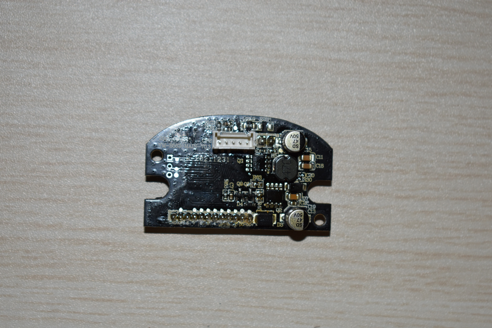
*Figure 1: Mainboard top view showing the 47 µH buck inductor, dual 50V filter capacitors, and motor output connector CN2.*

---

## 3. Mainboard Architecture (`YM-B563-MAIN-V0.3`)

The main circuit board carries the manufacturer silkscreen:
```text
YM-B563-MAIN-V0.3
Date: 2021-09-22
Batch: W 20211231
```

It is a double-sided, soldermask-green FR-4 PCB with high-current copper fills on the battery ground and Vm traces to minimize $I^2R$ resistive heating under heavy motor loading.

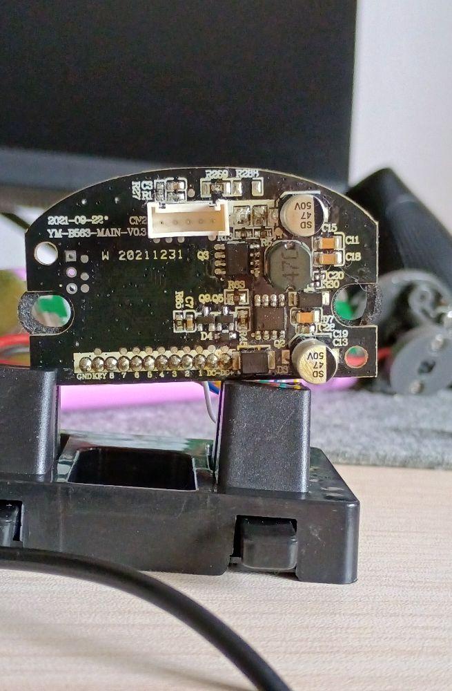
*Figure 2: Silkscreen reference of the top PCB layer detailing connector and component markings.*

### Connectors on Mainboard
1. **`CN2` (Top Edge)**: 5-pin JST-XH compatible shrouded horizontal connector for motor power and digital signaling (`PWM`, `GND`, `FR`, `FG`, `VCC`).
2. **`CN1` (Bottom Edge, Underside)**: 2-pin polarized connector for the 6S battery power harness (`BAT+`, `BAT-`).
3. **`CN4` (Bottom Edge, Underside)**: Wire-to-board connector for the UI daughterboard flex/ribbon harness.
4. **Bottom Pad Array**: 12 dedicated hand-soldered terminal pads (`GND`, `KEY`, `8`, `7`, `6`, `5`, `4`, `3`, `2`, `1`, `DC-`, `DC+`).
5. **`CN6` (Center Underside)**: 3-pad unpopulated programming header (`S`, `V`, `G`).

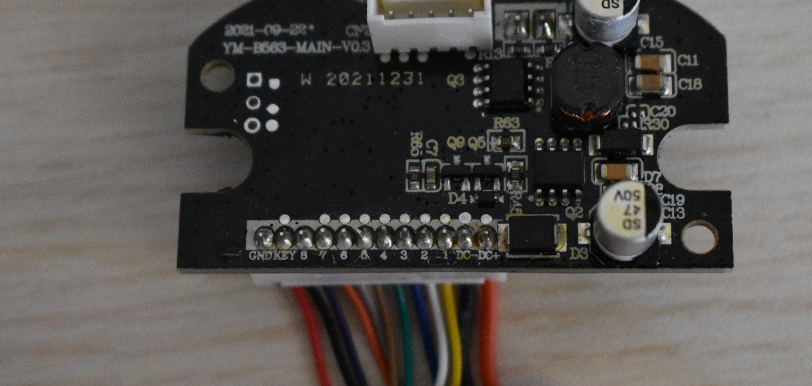
*Figure 3: Mainboard with attached wiring harness and connector terminations.*

---

## 4. Microcontroller & In-Circuit Programming Interface

The primary system controller is designated **`U4`**, packaged in a compact **TSSOP-20** (20-pin Thin Shrink Small Outline Package) on the bottom side of the PCB.

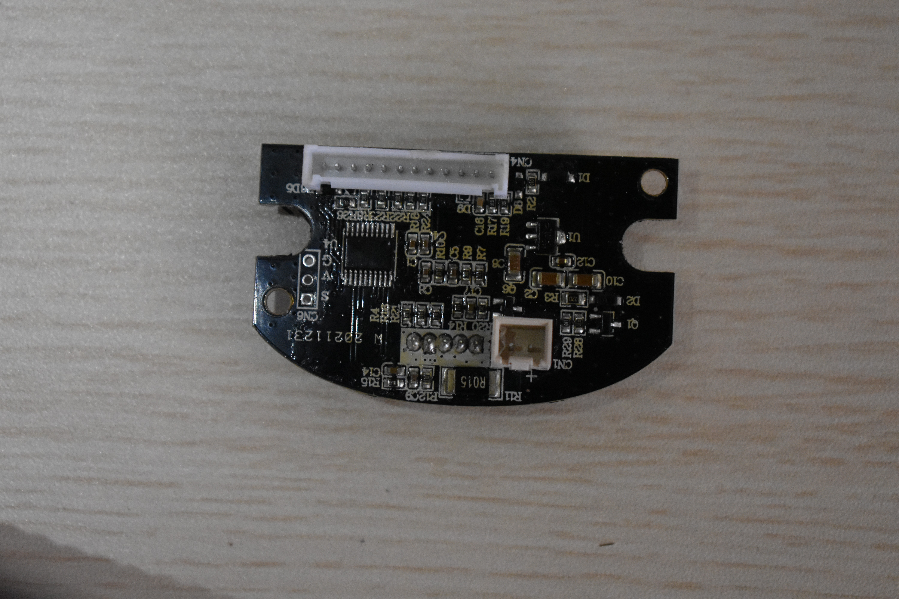
*Figure 4: Studio macro shot of mainboard underside highlighting TSSOP-20 microcontroller U4 and current shunt R015.*

### Microcontroller Responsibilities
- **Timer Generation**: Generates the 25 kHz ultrasonic PWM wave fed to CN2 Pin 5.
- **Tachometer Counting**: Reads FG pulse frequency (CN2 Pin 2) to detect stall conditions or motor desynchronization.
- **Current Monitoring**: Reads analog voltage drop across shunt resistor `R015`.
- **UI State Machine**: Debounces the shift push button, steps through gears (`Neutral -> Gear 1 -> Gear 2 -> Gear 3 -> Neutral`), and multiplexes the LED display.
- **Safety Timers**: 10-minute continuous run timeout counter and charging lockout.

### SWD / Serial Programming Header (`CN6`)
Directly adjacent to microcontroller `U4` lies an unpopulated 3-pin test port designated `CN6`:

| Pad | Silkscreen Marking | Signal Name | Electrical Level | Description |
|---|---|---|---|---|
| 1 | **`S`** | SWDIO / TX | 3.3V Logic | Single-wire data I/O or UART transmit |
| 2 | **`V`** | VDD / VCC | 3.3V DC | Target logic supply voltage |
| 3 | **`G`** | GND | 0V | Ground reference |

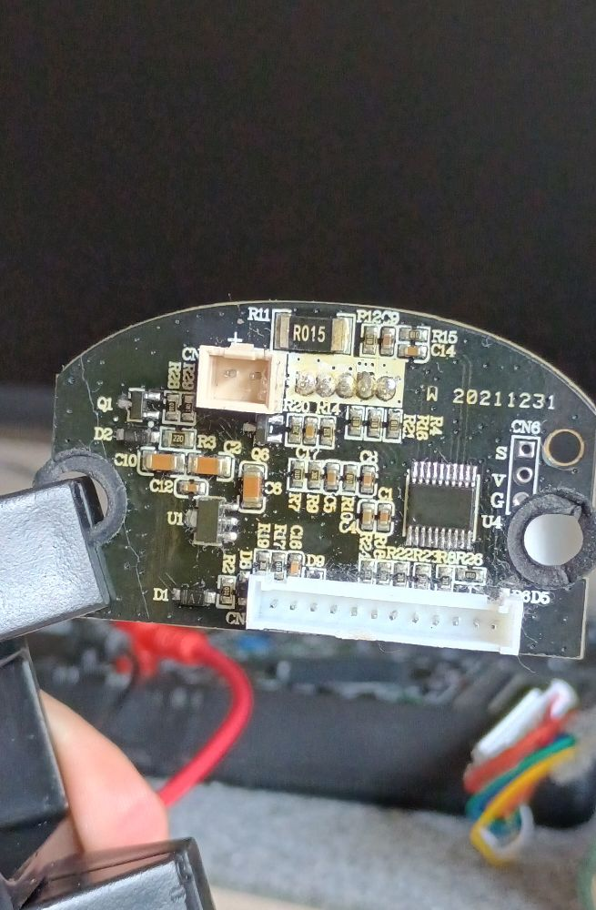
*Figure 5: High-magnification silkscreen detail of debug port CN6 and MCU decoupling network.*

---

## 5. Current Sensing & Locked-Rotor Protection

Mounted on the ground return path of the BLDC motor driver is a precision low-side current shunt resistor:
- **Component Code**: `R015`
- **Resistance Value**: **15 mΩ (0.015 Ω)**
- **Package**: Surface-mount 1206 or 2010 high-power metal alloy shunt.

### Measurement Principle
The motor current $I_{\text{motor}}$ returns to battery negative through `R015`, inducing a differential sense voltage:
$$V_{\text{sense}} = I_{\text{motor}} \times 0.015\,\Omega$$

| Motor Operating State | Estimated Current ($I_{\text{motor}}$) | Voltage Drop ($V_{\text{sense}}$) | MCU Action |
|---|---|---|---|
| **No-load idle (Gear 1)** | ~0.3 A | 4.5 mV | Normal operation |
| **Full speed (Gear 3)** | ~0.8 A – 1.2 A | 12.0 mV – 18.0 mV | Normal operation |
| **Heavy Percussive Load** | 2.5 A – 3.5 A | 37.5 mV – 52.5 mV | Monitored continuous load |
| **Locked-Rotor / Stall** | > 5.0 A | > 75.0 mV | Immediate PWM cut within 50 ms |

If the differential voltage exceeds the safe threshold, or if current draw is elevated while the FG tachometer pulse rate drops to 0 Hz, the MCU cuts the PWM drive signal to 0% to prevent burnout of the motor inverter FETs or battery cell over-stress.

---

## 6. Motor Controller & Integrated Inverter

The massage gun uses a **Dongguan E-S Motor Co., Ltd. 2430BL series** brushless DC motor equipped with an integrated 3-phase electronic driver board.

### Driver Architecture
- The driver board contains internal gate drivers and six power MOSFETs in a full 3-phase bridge topology.
- It incorporates built-in Hall effect sensors to sequence commutation.
- Control interface requires only low-power 3.3V/5V logic inputs from the mainboard.

### Electrical Interface Characteristics
- **Operating Voltage ($V_m$)**: 12V – 26V DC.
- **PWM Frequency**: 15 kHz – 25 kHz typical (maximum rating 60 kHz).
- **PWM Inversion**: Active-LOW ($V_{IH} \ge 2.0\text{V}$ = OFF; $V_{IL} \le 0.5\text{V}$ = ON).
- **Direction (FR)**: High or open = CCW; Low = CW.
- **Tachometer (FG)**: Open-collector Hall pulse train generating **exactly 6 pulses per mechanical revolution**.

---

## 7. User Interface Daughterboard (`2116 WLS V0.9`)

The user controls the device via a secondary PCB mounted in the top rear cap:
```text
Board Silkscreen: 2116 WLS V0.9
```

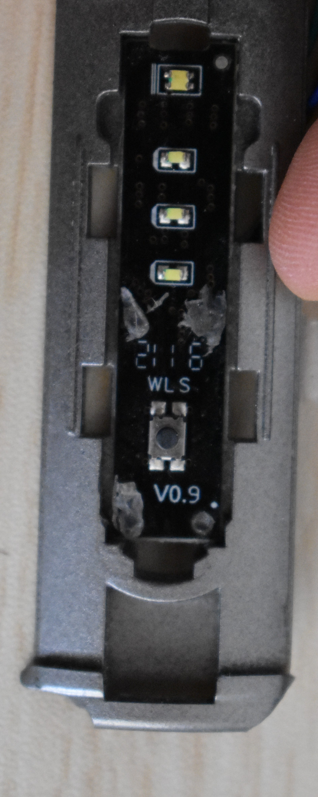
*Figure 6: UI daughterboard front face showing SMD indicator LEDs and tactile push button.*

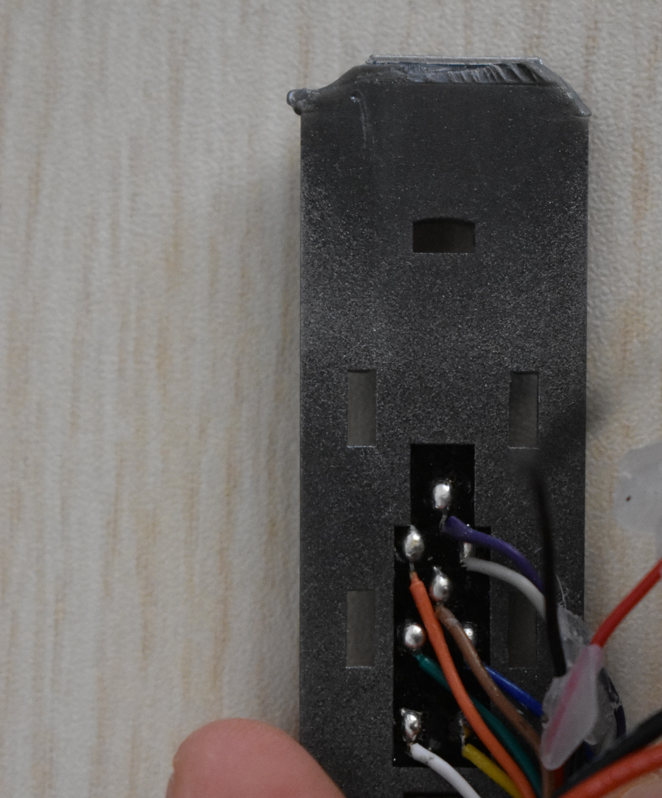
*Figure 7: UI daughterboard rear face detailing ribbon solder joints.*

### Components on UI Board
1. **Gear Intensity Indicators**: Three SMD LEDs (LED 1/3, LED 2/3, LED 3/3) corresponding to Gears 1, 2, and 3.
2. **Dual-Color Power Indicator**: One dual-color Red/White SMD LED:
   - **Solid White**: Battery capacity $\ge 20\%$.
   - **Solid Red**: Battery capacity $< 20\%$.
   - **Flashing Red**: Battery capacity $< 5\%$ (immediate recharge required).
   - **Flashing White**: Battery charging in progress.
   - **Solid White (Plugged in)**: Battery fully charged.
3. **Tactile Shift Button**: Momentary tactile switch cycling gears on each short press:
   $$\text{Standby/Neutral} \longrightarrow \text{Gear 1} \longrightarrow \text{Gear 2} \longrightarrow \text{Gear 3} \longrightarrow \text{Standby}$$

---

## 8. Battery Pack & JETECH BMS Analysis

The power source is a removable 6S lithium-ion cylindrical cell pack manufactured by **Shenzhen JETECH Energy Technology Co., Ltd.**:
- **Pack Model**: `JT-ESB06-05`
- **Cell Configuration**: **6S1P (6INR19/66)** using six high-discharge 18650 cylindrical cells.
- **Nominal Voltage**: **DC 21.6V** (3.6V per cell).
- **Rated Capacity**: **2.6 Ah (2600 mAh) / 56.16 Wh**.
- **Maximum Charge Voltage**: **25.2V DC** (4.2V per cell).
- **Discharge Cutoff Voltage**: **18.0V DC** (3.0V per cell).

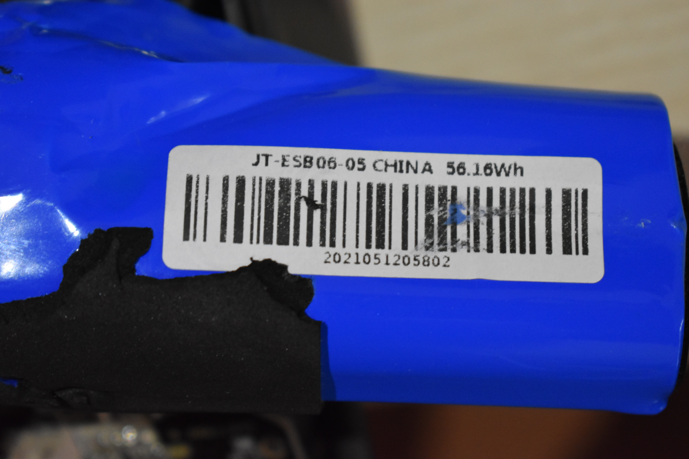
*Figure 8: High-resolution view of JETECH JT-ESB06-05 battery specification label.*

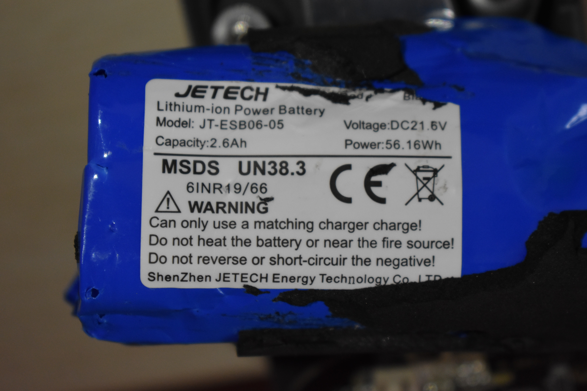
*Figure 9: Battery pack seated within the handle cavity.*

### Battery Management System (BMS) Board
- **Board Silkscreen**: `JETECH-90606-V3`
- **Balance Taps**: Features dedicated voltage sensing and cell balancing taps labeled `B-`, `B1`, `B2`, `B3`, `B4`, and `B+`.
- **Integrated Protection**:
  - Over-charge voltage detection ($4.25\text{V} \pm 0.05\text{V}$ per cell).
  - Over-discharge cutoff protection ($2.8\text{V} \pm 0.08\text{V}$ per cell).
  - Peak over-current cutoff.
  - Short-circuit protection with automatic recovery after fault clearance.

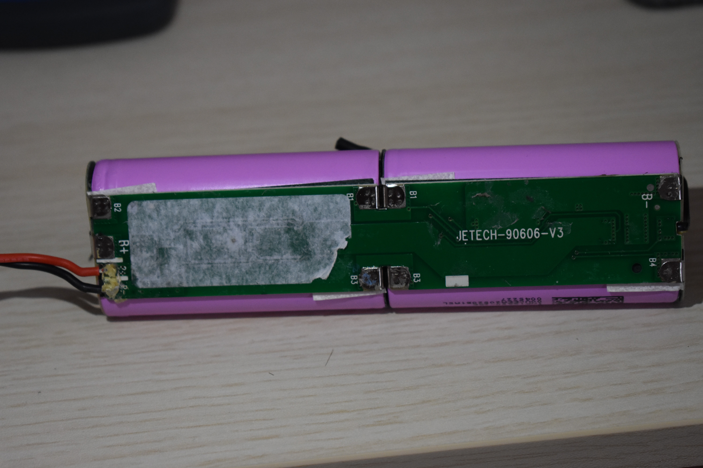
*Figure 10: 6S 18650 battery assembly showing JETECH-90606-V3 BMS board and balance tabs.*

---

## 9. AC/DC Wall Charger Specifications

The external power supply is an efficient switch-mode AC adapter manufactured by **QSHAIN**:
- **Model**: `YNQX36G260100VL`
- **Input Voltage**: $100\text{–}240\text{V} \sim 50/60\text{Hz}$, 1.0A Max.
- **Output Rating**: **26.0V DC == 1.0A (26.0 W)**.
- **Output Connector**: Coaxial barrel plug with **center-positive polarity** (`-(o-+`).
- **Internal Safety**: 250V T2.0A primary fuse, Class II double insulation (no earth ground required).
- **Manufacturing Batch**: `2203` (March 2022).

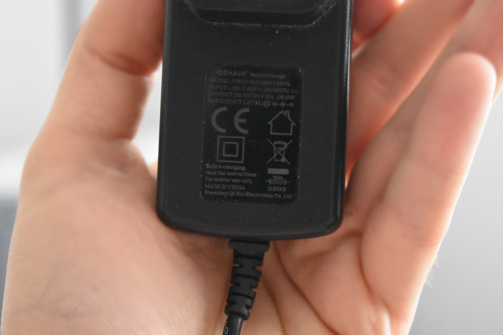
*Figure 11: Studio macro shot of the QSHAIN power adapter rating plate.*

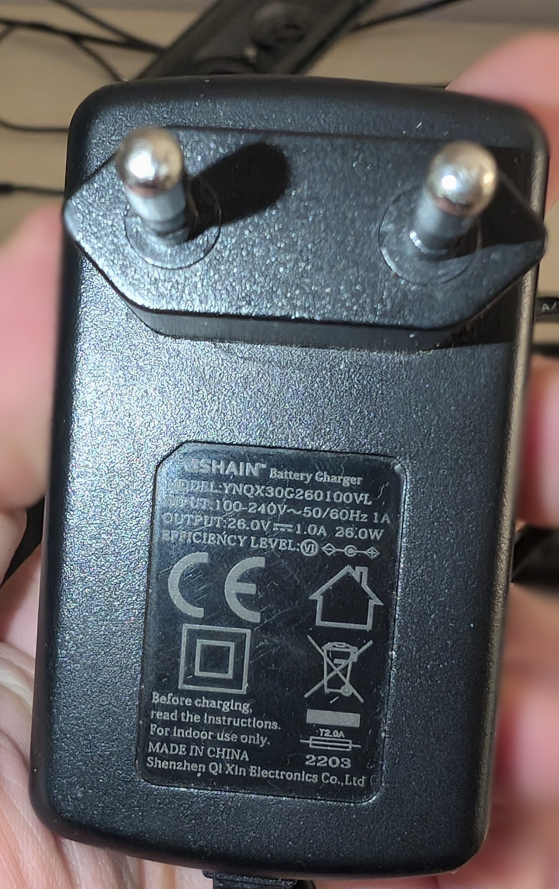
*Figure 12: European plug profile of the QSHAIN 26V power supply.*
