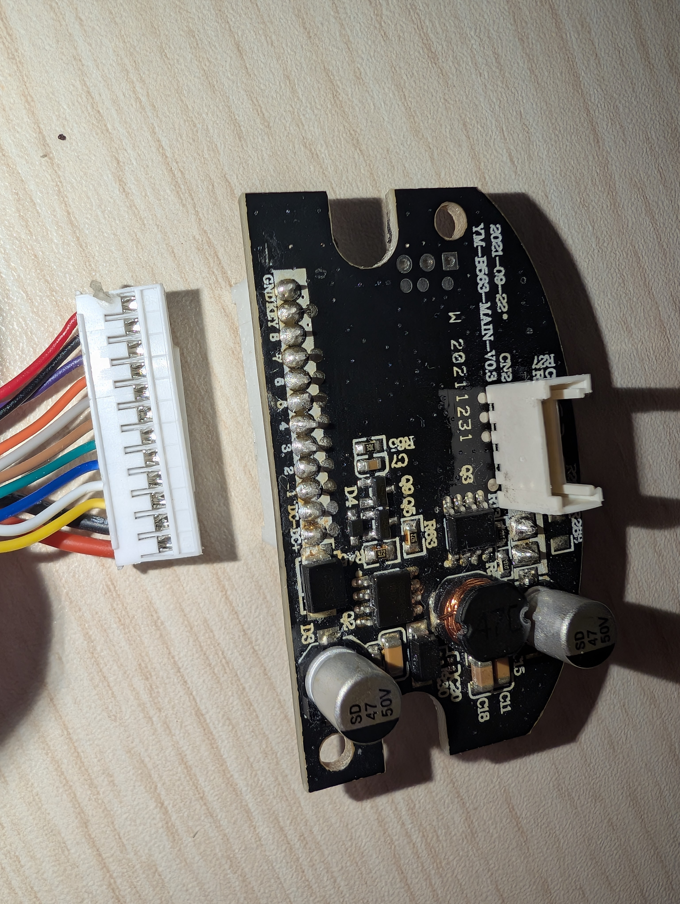
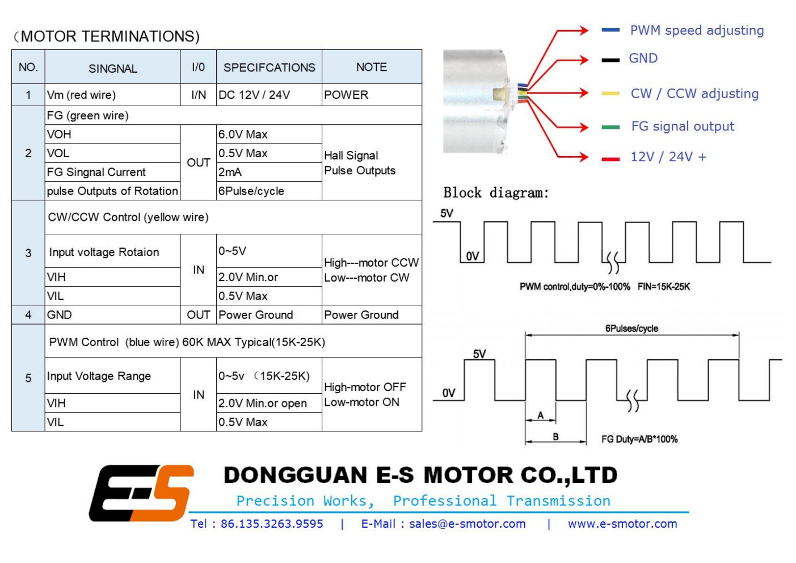
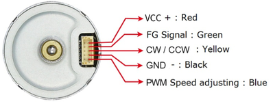
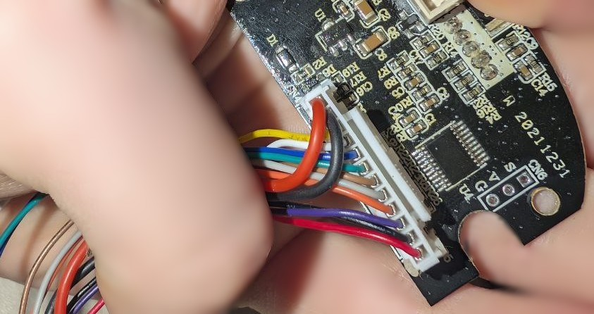

# Connector Pinouts, Signal Analysis & Wiring Hazard Warning

This document establishes the electrical specifications, connector pinouts, signal timings, waveform characteristics, and safety warnings for all wiring harnesses within the **Yunmai Massage Gun Pro (Model YMFG-B563)**.

---

## Table of Contents
1. [Critical Color-Coding Hazard Warning](#critical-color-coding-hazard-warning)
2. [Motor Interface Connector (`CN2`)](#motor-interface-connector-cn2)
3. [Motor Datasheet & Termination Reference](#motor-datasheet--termination-reference)
4. [Mainboard Bottom Solder Pad Array](#mainboard-bottom-solder-pad-array)
5. [Tachometer Speed Feedback (FG) Waveform & Calculations](#tachometer-speed-feedback-fg-waveform--calculations)
6. [PWM Speed Control Signal Characteristics](#pwm-speed-control-signal-characteristics)
7. [In-Circuit Programming Port (`CN6`)](#in-circuit-programming-port-cn6)
8. [Battery Main Power Connector (`CN1`)](#battery-main-power-connector-cn1)

---

## 1. Critical Color-Coding Hazard Warning

> ⚠️ **CRITICAL ELECTRICAL HAZARD — SEVERE WIRE COLOR VIOLATION** ⚠️
> 
> On the bottom solder pad array of motherboard **`YM-B563-MAIN-V0.3`**, the factory wiring harness violates universal electronics color conventions:
> 
> - Silkscreen Pad **`GND`** (System Logic Ground) is soldered to a **THIN RED WIRE**!
> - Silkscreen Pad **`KEY`** (Power switch sense line) is soldered to a **THIN BLACK WIRE**!
> 
> **NEVER ASSUME RED IS POWER AND BLACK IS GROUND ON THE INTERNAL HARNESS.**
> 
> If an engineer or technician connects the thin red wire to $+24\text{V}$ or $V_{CC}$ following standard conventions:
> 1. Activating the power switch creates a **direct dead short across the 21.6V lithium-ion battery pack**.
> 2. The high short-circuit current will vaporize PCB traces, destroy the switch contacts, and potentially trigger BMS latch-up or fire.
> 
> **RULE: ALWAYS FOLLOW SILKSCREEN LABELS PRINTED ON THE PCB OVER WIRE INSULATION COLORS.**


*Figure 1: Close-up of desoldered motherboard terminal pads showing silkscreen labels GND and KEY alongside the harness.*

---

## 2. Motor Interface Connector (`CN2`)

The motor interface connector **`CN2`** is a 5-pin shrouded connector located on the top edge of the mainboard. It mates with the wire harness originating from the **Dongguan E-S Motor 2430BL** integrated brushless driver.

```text
               CN2 Motor Connector (Top Edge of Mainboard)
               +-----------------------------------------+
               |  [ 1 ]    [ 2 ]    [ 3 ]    [ 4 ]    [ 5 ] |
               +-----------------------------------------+
                  Vm        FG       FR       GND      PWM
                 (Red)    (White)  (Yellow) (Black)   (Blue)
```

### CN2 Pinout Table

| Pin # | Silk Mark | Wire Color | Signal Name | Voltage Level | Signal Type | Description |
|:---:|:---:|:---:|:---:|:---:|:---:|:---|
| **1** | `VCC` / `Vm` | **Red** (Thick) | Motor Power Supply | 21.6V – 26.0V DC | Power Input | High-current DC bus connected to 6S battery pack positive |
| **2** | `FG` | **White** (Thick) | Frequency Generator | 0V – 5.0V / 3.3V | Digital Output | Open-collector Hall speed tachometer: **6 pulses per revolution** |
| **3** | `FR` | **Yellow** (Thick) | Forward / Reverse | 0V – 5.0V | Digital Input | Direction control ($V_{IH} \ge 2.0\text{V}$ = CCW, $V_{IL} \le 0.5\text{V}$ = CW) |
| **4** | `GND` | **Black** (Thick) | Power & Logic Ground | 0V | Ground | High-current ground return path |
| **5** | `PWM` | **Blue** (or Purple) | Speed Modulation | 0V – 5.0V | Digital Input | Ultrasonic active-LOW PWM (**15 kHz – 25 kHz**, max 60 kHz) |

*Note*: On the motor end-bell silkscreen itself, the order is stamped as: `PWM  GND  FR  FG  VCC` (Pin 5 to Pin 1).

---

## 3. Motor Datasheet & Termination Reference

The brushless motor is manufactured by **Dongguan E-S Motor Co., Ltd.** (Series: `25SG-2430BL`).


*Figure 2: Official manufacturer datasheet for the Dongguan E-S Motor 25SG-2430BL integrated brushless driver.*


*Figure 3: Motor end-bell connector termination diagram and pin assignment.*

### Manufacturer Termination Specifications
- **Termination 1 (Vm)**: Red wire, DC 12V / 24V power supply.
- **Termination 2 (FG)**: Green/White wire, Hall signal pulse output:
  - $V_{OH} \le 6.0\text{V}$ Max (requires external pull-up).
  - $V_{OL} \le 0.5\text{V}$ Max.
  - Maximum output sink current: $2\,\text{mA}$.
  - Resolution: **6 Pulses / mechanical cycle**.
- **Termination 3 (CW/CCW Control)**: Yellow wire:
  - $V_{IH} \ge 2.0\text{V}$ Min or Open Circuit $\longrightarrow$ High: Motor CCW.
  - $V_{IL} \le 0.5\text{V}$ Max $\longrightarrow$ Low: Motor CW.
- **Termination 4 (GND)**: Black wire, Power Ground.
- **Termination 5 (PWM Control)**: Blue wire:
  - Typical frequency: **15 kHz – 25 kHz** (60 kHz absolute max).
  - $V_{IH} \ge 2.0\text{V}$ Min or Open Circuit $\longrightarrow$ High: Motor OFF.
  - $V_{IL} \le 0.5\text{V}$ Max $\longrightarrow$ Low: Motor ON (Active-LOW modulation).

---

## 4. Mainboard Bottom Solder Pad Array

The bottom edge of motherboard `YM-B563-MAIN-V0.3` features 12 hand-soldered wire pads linking the board to the base power switch, DC charging receptacle, and top-cap UI daughterboard.


*Figure 4: Underside view of mainboard showing wire harness terminations.*

### Pad Assignment Table

| Pad Label | Wire Color | Gauge | Connected Subsystem | Functional Role | Electrical Potential |
|---|---|---|---|---|---|
| **`DC+`** | Black | Thick (20 AWG) | DC Barrel Receptacle | Battery Charger Positive Input | +26.0V DC (when charging) |
| **`DC-`** | Black | Thick (20 AWG) | DC Barrel Receptacle | Battery Charger Return Ground | 0V (Chassis Ground) |
| **`1`** | **Yellow** | Thin (28 AWG) | UI Board (`2116 WLS`) | Common Anode for All 4 SMD LEDs | +5.0V Logic Rail |
| **`2`** | **White** | Thin (28 AWG) | UI Board (`2116 WLS`) | Dual-color LED: Red Cathode | Active-LOW (Sinks to GND) |
| **`3`** | **Blue** | Thin (28 AWG) | UI Board (`2116 WLS`) | Dual-color LED: White Cathode | Active-LOW (Sinks to GND) |
| **`4`** | **Green** | Thin (28 AWG) | UI Board (`2116 WLS`) | Gear 1/3 LED Cathode | Active-LOW (Sinks to GND) |
| **`5`** | **Brown** | Thin (28 AWG) | UI Board (`2116 WLS`) | Gear 2/3 LED Cathode | Active-LOW (Sinks to GND) |
| **`6`** | **Grey** | Thin (28 AWG) | UI Board (`2116 WLS`) | Gear 3/3 LED Cathode | Active-LOW (Sinks to GND) |
| **`7`** | **Orange** | Thin (28 AWG) | UI Board (`2116 WLS`) | Tactile Shift Button Terminal A | Pulled HIGH by MCU (3.3V) |
| **`8`** | **Violet** | Thin (28 AWG) | UI Board (`2116 WLS`) | Tactile Shift Button Terminal B | Switched to GND on press |
| **`KEY`** | **Black** | Thin (28 AWG) | Bottom Power Rocker Switch | Power Switch Logic Sense | Switched to GND when ON |
| **`GND`** | **RED** | Thin (28 AWG) | Bottom Power Rocker Switch | Logic Ground Reference | **0V Ground** (Hazard!) |

---

## 5. Tachometer Speed Feedback (FG) Waveform & Calculations

The `FG` signal from the motor driver is driven by internal rotor Hall sensors through an open-collector NPN transistor. An external pull-up resistor (typically $4.7\,\text{k}\Omega$ to $10\,\text{k}\Omega$) on the motherboard pulls the line to $3.3\text{V}$ or $5.0\text{V}$.

```text
       +5V/3.3V
          |
         [R] 10k Pull-up
          |
FG Pin ---+----------> To MCU Input Capture Pin
          |
        | /
        --   Open-Collector NPN inside Motor Driver
        | \
          |
         GND
```

### Pulse Rate & RPM Conversion
Because the motor driver outputs **exactly 6 pulses per mechanical revolution**, the rotational speed in RPM relates to the output frequency $f_{\text{FG}}$ by:

$$\text{RPM} = \frac{f_{\text{FG}} \times 60}{\text{Pulses per Revolution}} = \frac{f_{\text{FG}} \times 60}{6} = 10 \times f_{\text{FG}}$$

Conversely, the expected tachometer frequency for any target RPM is:
$$f_{\text{FG}} = \frac{\text{RPM}}{10}$$

### Operating Gear Speeds & Expected Frequency

| Gear Mode | Target Motor Speed | Percussion Frequency | Expected FG Frequency ($f_{\text{FG}}$) | FG Pulse Period ($T_{\text{FG}}$) |
|---|---|---|---|---|
| **Gear 1** | 1,800 RPM | 30 Hz (percussions/sec) | **180 Hz** | 5.55 ms |
| **Gear 2** | 2,400 RPM | 40 Hz (percussions/sec) | **240 Hz** | 4.16 ms |
| **Gear 3** | 3,200 RPM | 53.3 Hz (percussions/sec)| **320 Hz** | 3.12 ms |

If the MCU senses $f_{\text{FG}} = 0\,\text{Hz}$ while commanding a non-zero PWM duty cycle, it flags a **motor stall / locked rotor event** and executes an emergency shutdown.

---

## 6. PWM Speed Control Signal Characteristics

The speed of the BLDC motor is governed by an active-LOW pulse-width modulated square wave applied to CN2 Pin 5.

```text
                          ACTIVE-LOW PWM MODULATION
                          
  100% OFF (0% Speed):
  5V +-------------------------------------------------------------------+
     |
  0V +-------------------------------------------------------------------+
  
  50% Speed:
  5V +-------+       +-------+       +-------+       +-------+       +---+
     |       |       |       |       |       |       |       |       |
  0V +       +-------+       +-------+       +-------+       +-------+   
             |<-t_low>|
             |<------- T_period (40 us @ 25 kHz) --------->|
  
  100% Speed:
  5V +-------------------------------------------------------------------+
     
  0V +-------------------------------------------------------------------+
```

### Signal Specifications
- **Carrier Frequency**: Nominally **25.0 kHz** ($T_{\text{period}} = 40.0\,\mu\text{s}$). Valid range: $15.0\,\text{kHz}$ to $25.0\,\text{kHz}$.
- **Input Impedance**: Internal pull-up to $5\text{V}$ logic ($R_{\text{in}} \approx 10\,\text{k}\Omega$).
- **Logic High Level ($V_{IH}$)**: $\ge 2.0\text{V}$ (Motor de-energized).
- **Logic Low Level ($V_{IL}$)**: $\le 0.5\text{V}$ (Motor energized).
- **Effective Motor Speed Transfer Function**:
  $$\text{Effective Speed } (\%) = 100\% - \text{Duty}_{\text{High}} = \frac{t_{\text{Low}}}{T_{\text{period}}} \times 100\%$$

---

## 7. In-Circuit Programming Port (`CN6`)

Mounted near microcontroller `U4` on the PCB underside:

```text
               +---------------+
               | [S]  [V]  [G] |  (CN6 Silkscreen)
               +---------------+
```

| Pad | Silk | Name | Description |
|:---:|:---:|---|---|
| **1** | `S` | SWDIO / TX | Serial data or single-wire debug line |
| **2** | `V` | VDD | 3.3V target power rail |
| **3** | `G` | GND | Logic ground reference |

---

## 8. Battery Main Power Connector (`CN1`)

The 6S lithium-ion battery connects to the underside of the mainboard via connector **`CN1`**:
- **Pin 1 (`BAT+`)**: Connects to battery positive via Red 18 AWG lead ($+21.6\text{V}$ nominal, up to $+25.2\text{V}$).
- **Pin 2 (`BAT-`)**: Connects to battery negative via Black 18 AWG lead ($0\text{V}$ ground).
